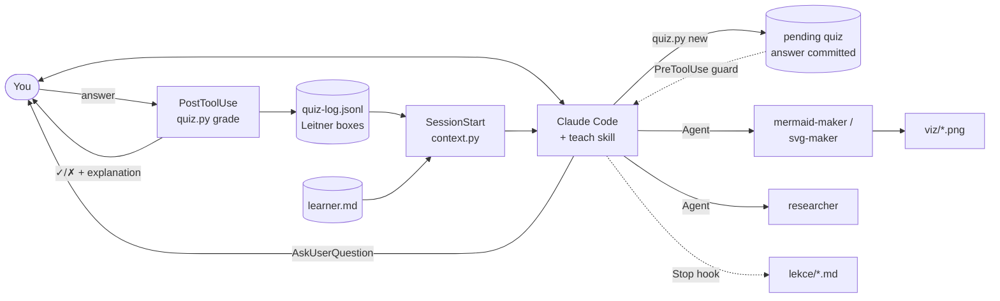

<div align="center">

# 🎓 learn-claude-code

**A personal AI tutor that runs inside [Claude Code](https://claude.com/claude-code). It teaches for understanding, not memorization.**

It probes what you already know, plans a lesson from first principles, and checks every step with graded quizzes.
Lessons are logged to Markdown with LaTeX and diagrams, and it remembers your progress across sessions.


</div>

---

This is a port of [**amosblomqvist/learn**](https://github.com/amosblomqvist/learn), the pi-agent learning system from the video
[*How I Use AI to Learn Things*](https://www.youtube.com/watch?v=kzcI5F4tGiU). The port rebuilds it on Claude Code primitives
(skills, subagents, hooks and slash commands) and extends it with memory, spaced repetition and verified answer keys.

The bundled example subject is **equations with a parameter** (Czech high-school math, *rovnice s parametrem*), taught in Czech.
To teach anything else, swap two files.

## ✨ What it does

| | |
|---|---|
| 🧭 **Probe → Plan → Teach** | It finds the exact edge of your knowledge with adaptive quizzes. It then proposes a lesson plan as a dependency graph and waits for your OK before teaching. |
| 🧱 **First principles** | Every lesson is built from *unconditional truths* you can accept at face value. Each step is motivated by asking "how could I have discovered this?", in the style of 3Blue1Brown. |
| ✅ **Honestly graded quizzes** | The correct answer is committed *before* you see the question and the options are shuffled. A hook grades you instantly (✓/✗, correct answer, explanation), so the model can't fudge the grade. |
| 🤷 **"I don't know" is a real answer** | Saying *nevím / I don't know* is recorded as an honest gap, not as a wrong guess. You can attach a note to any answer. |
| ✍️ **Production, not just recognition** | You write full solutions yourself. They are graded against a fixed rubric and checked against a verified answer key, not judged by feel. |
| 🔁 **Spaced repetition** | Every quiz is logged and moves through Leitner boxes (reviewed after 1, 3, 7 and 21 days). Items that are due are replayed at the start of each session. |
| 🧠 **Memory across sessions** | `learner.md` holds your knowledge edge, error patterns and plan progress. A hook injects it automatically when a session starts. |
| 🖼️ **Verified visuals** | Subagents author Mermaid or SVG diagrams, render them, look at the PNG, and fix them until they are correct. |
| 📝 **Lesson log** | The whole session is mirrored live to `lekce/*.md`. Open it in Obsidian or a VS Code preview to see rendered LaTeX, diagrams and quiz results. |
| 🔎 **Fact checking** | A `researcher` subagent verifies any claim the tutor is unsure of before it is taught. |

## 🚀 Quick start

```bash
git clone https://github.com/cufelix/learn-claude-code
cd learn-claude-code
(cd .claude/learn && npm install)   # mermaid-cli + puppeteer, for diagrams
pip install sympy                   # answer-key verification
claude "teach me"                   # accept "trust this folder", otherwise hooks don't run
```

Then open the folder in **Obsidian** next to your terminal and watch `lekce/` fill up as you learn.

> **Requirements:** Claude Code, Python 3.10+, Node 18+, and Google Chrome or Chromium (used for SVG rendering).

## 🕹️ Commands

| Command | What it does |
|---|---|
| `/lekce` | Start or resume a lesson: due reviews first, then the next node of the plan |
| `/kviz` | Quick drill: 5 quizzes aimed at your weakest error tags plus due reviews |
| `/pokrok` | Progress report: score, top mistakes, finished nodes, next step |
| `/md-log [name.md]` | Choose which file in `lekce/` the session is mirrored to |
| `/md-unlog` | Stop mirroring |

The status line keeps your score visible:

```
📚 ✓12 ✗3 ∅1 · série 4 · k opakování 2
```

That reads as 12 correct, 3 wrong, 1 "don't know", a streak of 4, and 2 reviews due (Czech labels, since the example subject is taught in Czech).

## ⚙️ How it works



<details>
<summary><b>Life of a quiz</b></summary>

1. Claude writes the quiz as JSON: question, 2–4 options, the correct value, an explanation and an error tag. It pipes this to `quiz.py new`.
2. `quiz.py` **rejects unfair quizzes**: an option that carries its own justification, a correct answer visibly longer than the distractors, ambiguous labels, or a hand-made "I don't know" option.
3. It shuffles the options, saves the quiz with its answer, and prints the exact `AskUserQuestion` input.
4. A **PreToolUse guard** blocks the question if Claude paraphrases or reorders it, because that would break grading.
5. You answer. The **PostToolUse hook** grades the answer, shows you ✓/✗ with the explanation, tells Claude what the answer reveals, and logs it for spaced review.

</details>

<details>
<summary><b>Mapping from the original pi system</b></summary>

| amosblomqvist/learn (pi) | This repo (Claude Code) |
|---|---|
| `skills/teach` | `.claude/skills/teach/`: same philosophy, plus tooling, memory, production and mastery-gate sections |
| `skills/visualize` | `.claude/skills/visualize/` |
| `agents/researcher` (`web_search`, `safe_bash`) | `.claude/agents/researcher.md` (`WebSearch`, `WebFetch`) |
| `agents/mermaid-maker`, `agents/svg-maker` | `.claude/agents/*-maker.md` |
| `extensions/quiz.ts` | `.claude/learn/quiz.py` + PreToolUse / PostToolUse hooks |
| `extensions/ask-user-question.ts` | Built-in `AskUserQuestion` |
| `extensions/md-log.ts` + `/md-log`, `/md-unlog` | `.claude/learn/md_log.py` (hooks) + `.claude/commands/` |
| `extensions/visual-tools` | `.claude/learn/render.mjs` |
| `pi-interactive-subagents` | Native Claude Code subagents |

**Differences from the original:**
- `AskUserQuestion` allows at most 4 options.
- "I don't know" is typed via *Other* instead of being a fixed button.
- Option labels are plain text, so math in options is written in Unicode (`x² − 1`). LaTeX is used in explanations and in the log.

</details>

<details>
<summary><b>Project layout</b></summary>

```
.claude/
├── skills/
│   ├── teach/        # the teaching method (probe → plan → teach)
│   ├── visualize/    # when and how to add a diagram
│   ├── lekce/  kviz/  pokrok/   # slash commands
├── agents/           # researcher, mermaid-maker, svg-maker
├── commands/         # /md-log, /md-unlog
├── learn/
│   ├── quiz.py       # graded quizzes, guard, stats, spaced review
│   ├── md_log.py     # lesson log hook
│   ├── context.py    # SessionStart: learner state → Claude
│   ├── render.mjs    # Mermaid / SVG → PNG
│   ├── klic.py       # sympy-verified answer key (example subject)
│   └── reseni.md     # worked solutions (example subject)
└── settings.json     # hooks, permissions, status line
CLAUDE.md             # tutor instructions for this project
cil.md                # the learning goal / assignment
```

</details>

## 🎨 Make it yours

1. Replace **`cil.md`** with your goal: an exam syllabus, a book chapter, or "explain TCP to me".
2. Edit **`CLAUDE.md`** to set the language, the subject and what success means.
3. Delete `.claude/learn/klic.py` and `reseni.md`, which are the answer key for the example subject. Optionally write a key for your own subject.
4. Tune `.claude/skills/teach/SKILL.md` to how *you* learn best. The original author encourages this.

## 🔒 Security notes

- Helper scripts are auto-allowed, so they only accept constrained input:
  - `render.mjs` reads only `viz/src/*.mmd|svg`. It renders SVG with the browser sandbox on, JavaScript disabled and no network.
  - `md_log.py` writes only inside `lekce/`.
  - `klic.py` accepts only numbers and fractions.
- Your personal data stays out of git: `learner.md`, the quiz log, lessons and visuals are all git-ignored.

## 🙏 Credits & license

- The teaching philosophy, the original skills and the agent prompts are by **[Amos Blomqvist](https://github.com/amosblomqvist)**, from [amosblomqvist/learn](https://github.com/amosblomqvist/learn).
- The original repo has no license. The derived skill and agent texts remain the author's work.
- The code of this port is MIT licensed. That covers `.claude/learn/*`, the hooks and the commands.
